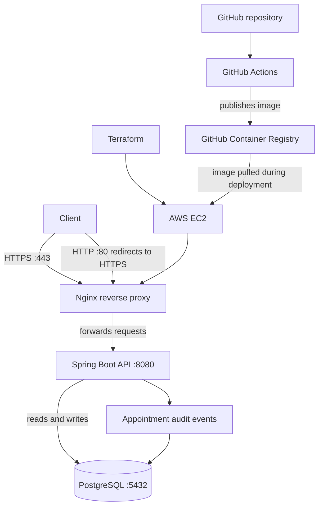

# Hospital Management Platform – Doctor Appointment API

This project is a REST API for managing doctor appointments. Patients can sign in, view doctors and available slots, and book, reschedule or cancel appointments. The application uses Spring Boot and PostgreSQL, runs through Docker Compose, and is served through Nginx on an AWS EC2 instance.

**Repository:** [Hospital Management Platform](https://github.com/Akhilreddy175/Hospital-Management-Platform)  
**Live deployment:** `3.109.203.28`  
**Health check:** [https://3.109.203.28/actuator/health](https://3.109.203.28/actuator/health)  
**Doctors API:** [https://3.109.203.28/api/v1/doctors](https://3.109.203.28/api/v1/doctors)  
**Container image:** `ghcr.io/akhilreddy175/hospital-appointment-service:latest`

> The deployment currently uses a self-signed TLS certificate. HTTPS traffic is encrypted, but browsers and clients will not automatically trust this certificate. The `curl -k` option is used in the examples to allow testing with that certificate.

## What the API supports

- Patient login using JWT authentication.
- Listing active doctors and their available time slots.
- Booking, rescheduling and cancelling appointments.
- Preventing conflicting bookings for the same doctor and appointment time.
- Recording appointment-related audit events.
- Health, liveness and readiness endpoints.

The project uses synthetic seed data only. Do not add real patient information.

## Technology

| Area | Technology |
|---|---|
| Backend | Java 17, Spring Boot 3.4, Spring Security |
| Database | PostgreSQL 16, Flyway |
| Authentication | JWT |
| Containers | Docker, Docker Compose |
| Reverse proxy | Nginx |
| Infrastructure | Terraform, AWS EC2 |
| CI/CD and registry | GitHub Actions, GitHub Container Registry |
| Image scanning | Trivy |

## How the services fit together



GitHub Actions builds and checks the application image before publishing it to GHCR. Terraform is used to provision the EC2 host. On the host, Docker Compose runs the API, database and Nginx services.

## Repository layout

```text
.github/workflows/   GitHub Actions workflow
backend/             Spring Boot application and Dockerfile
nginx/               Nginx configuration and certificate scripts
scripts/             Database backup, restore and image rollback scripts
terraform/           AWS infrastructure configuration
docker-compose.yml   Application services
.env.example         Environment variable template
README.md            Project overview and setup
RUNBOOK.md           Operational commands and recovery steps
```

## Run locally

You need Git, Docker and Docker Compose. Run the commands from the repository root.

1. Clone the repository and enter the project directory:

   ```bash
   git clone https://github.com/Akhilreddy175/Hospital-Management-Platform.git
   cd Hospital-Management-Platform
   ```

2. Create your local environment file:

   ```bash
   cp .env.example .env
   ```

   On Windows PowerShell, use `Copy-Item .env.example .env`. Edit `.env` and set your own database password and JWT signing secret. Keep this file out of Git.

3. Generate the local Nginx certificate. Use the script for your environment:

   ```bash
   bash nginx/generate-certs.sh
   ```

   For Windows PowerShell:

   ```powershell
   .\nginx\generate-certs.ps1
   ```

4. Start the services:

   ```bash
   docker compose up -d
   ```

5. Check the containers and application health:

   ```bash
   docker compose ps
   curl -k https://localhost/actuator/health
   ```

The health response should report `UP` when the application and its required dependencies are healthy. Because the local certificate is self-signed, `curl -k` skips certificate trust validation; it should not be used as a general production security workaround.

To stop the services without deleting the database volume:

```bash
docker compose down
```

## Configuration

Copy `.env.example` to `.env` and use the variable names defined there. The current application configuration includes database credentials, the JWT signing secret and token lifetime, and the image owner/tag used by Compose. Check `.env.example` before changing values; do not rely on example secrets for a deployed environment.

Never commit `.env`, passwords, access tokens, private keys or TLS private keys.

## API endpoints

The deployed base URL is `https://3.109.203.28`. The local base URL is `https://localhost`.

| Method | Endpoint | Purpose | Authentication |
|---|---|---|---|
| `POST` | `/api/v1/auth/login` | Sign in and receive a JWT | Not required |
| `GET` | `/api/v1/doctors` | List active doctors | Not required |
| `GET` | `/api/v1/doctors/{id}/slots?date=YYYY-MM-DD` | View a doctor's available slots | Not required |
| `POST` | `/api/v1/appointments` | Book an appointment | Bearer token |
| `GET` | `/api/v1/appointments/my` | View the signed-in patient's appointments | Bearer token |
| `PUT` | `/api/v1/appointments/{id}/reschedule` | Reschedule an appointment | Bearer token |
| `DELETE` | `/api/v1/appointments/{id}` | Cancel an appointment | Bearer token |
| `GET` | `/actuator/health` | Check application health | Not required |
| `GET` | `/actuator/health/liveness` | Check whether the application is running | Not required |
| `GET` | `/actuator/health/readiness` | Check whether the application is ready | Not required |

Example live checks:

- [Doctors API](https://3.109.203.28/api/v1/doctors)
- [HTTPS health endpoint](https://3.109.203.28/actuator/health)
- [HTTP endpoint](http://3.109.203.28/actuator/health) — redirects to HTTPS with status `301`.

The live endpoints use the self-signed certificate described above. A browser warning is expected until a certificate issued by a trusted certificate authority is configured.

## Appointment conflict handling

The application checks whether the requested doctor and time slot are already occupied before creating an appointment. The database also has a uniqueness constraint for the doctor and appointment time. The concurrency test sends competing requests for the same slot and checks that both requests cannot create a confirmed booking.

A cancelled appointment and a new booking for the same slot should be checked against the actual database constraint and application behaviour before relying on slot reuse. The database constraint must not be described as allowing slot reuse unless that behaviour has been verified.

## CI/CD and deployment

The workflow is located at `.github/workflows/ci-cd.yml`. It runs the configured Maven checks and tests, builds and scans the container image, and publishes the image to GHCR for the configured branch/event. The published image is:

```text
ghcr.io/akhilreddy175/hospital-appointment-service:latest
```

Terraform configuration is in `terraform/`. It provisions the EC2 environment. The EC2 security group is configured for SSH, HTTP and HTTPS access; the API and database are used by the application stack behind the reverse proxy. Check the Terraform and Compose files before changing network exposure.

For deployment commands, service restart, logs, backup, restore and rollback, follow [RUNBOOK.md](RUNBOOK.md).

## Further information

- [Source code and CI workflow](https://github.com/Akhilreddy175/Hospital-Management-Platform)
- [Container package on GHCR](https://github.com/Akhilreddy175/Hospital-Management-Platform/pkgs/container/hospital-appointment-service)
- [Operations runbook](RUNBOOK.md)
