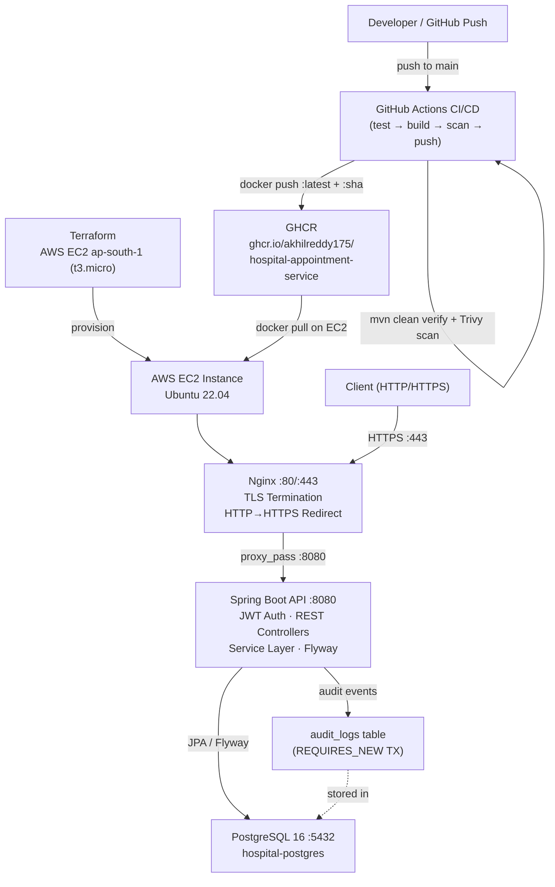

# Hospital Management Platform — Doctor Appointment API

A backend REST API for managing doctor appointments at a hospital. Patients authenticate, browse active doctors, check available time slots, and book appointments. The service runs on Spring Boot 3.4, is containerised with Docker Compose, reverse-proxied by Nginx over HTTPS, and deployed to AWS EC2 via Terraform. The CI/CD pipeline runs on GitHub Actions and publishes images to GHCR.

---

## Features

- JWT-based authentication (login, stateless sessions)
- Browse active doctors and available hourly slots
- Book, reschedule, and cancel appointments
- Dual-layer concurrent booking protection (application-level JPQL check + database `UNIQUE` constraint)
- Full audit log for every booking, reschedule, and cancellation
- HTTPS via self-signed TLS certificates terminated at Nginx
- Spring Boot Actuator health probes (`/actuator/health/liveness`, `/actuator/health/readiness`)
- Automated database backup, restore, and application rollback scripts

---

## Technology Stack

| Layer | Technology |
|---|---|
| Language | Java 17 |
| Framework | Spring Boot 3.4, Spring Security |
| Database | PostgreSQL 16 |
| Migrations | Flyway |
| Auth | JWT (JJWT 0.12.6, HMAC-SHA256) |
| Containers | Docker, Docker Compose |
| Reverse Proxy | Nginx (TLS termination, HTTP→HTTPS redirect) |
| Logging | Logback + Logstash JSON encoder |
| IaC | Terraform (AWS EC2, ap-south-1) |
| CI/CD | GitHub Actions, GHCR |
| Security Scan | Trivy |

---

## Architecture



---

## Project Structure

```
Hospital Management Platform/
├── .github/workflows/ci-cd.yml     # GitHub Actions pipeline
├── backend/
│   ├── Dockerfile                  # 2-stage Maven → JRE Alpine build
│   ├── pom.xml
│   └── src/main/java/com/algions/hospital/
│       ├── controller/             # REST endpoints
│       ├── service/                # Business logic
│       ├── repository/             # Spring Data JPA
│       ├── entity/                 # JPA entities
│       ├── security/               # JWT filter, SecurityConfig
│       ├── dto/                    # Request/response records
│       ├── config/                 # GlobalExceptionHandler
│       └── exception/              # SlotConflictException, ResourceNotFoundException
│   └── src/main/resources/
│       ├── application.yml
│       ├── application-test.yml    # H2 (PostgreSQL mode) for unit tests
│       └── db/migration/           # Flyway: V1 schema + V2 seed data
├── docker-compose.yml              # hospital-postgres · hospital-api · hospital-nginx
├── nginx/
│   ├── nginx.conf                  # TLS config, security headers, proxy
│   ├── generate-certs.sh           # Self-signed cert generation (Linux/macOS)
│   └── generate-certs.ps1          # Self-signed cert generation (Windows)
├── scripts/
│   ├── backup.sh                   # pg_dump to host filesystem
│   ├── restore.sh                  # psql restore from dump file
│   └── rollback.sh                 # Pull target image tag, restart api service
├── terraform/
│   ├── main.tf                     # EC2 instance + user_data bootstrap
│   ├── security_groups.tf          # Ports 22, 80, 443
│   ├── variables.tf
│   └── outputs.tf
└── .env.example                    # Environment variable template
```

---

## Prerequisites

- Docker and Docker Compose
- OpenSSL (for TLS certificate generation)
- Git

For Terraform provisioning: AWS CLI configured, Terraform ≥ 1.5.0, an existing EC2 key pair.

---

## Running Locally

**1. Clone the repository**

```bash
git clone https://github.com/Akhilreddy175/Hospital-Management-Platform.git
cd Hospital-Management-Platform
```

**2. Create the environment file**

```bash
cp .env.example .env
```

Edit `.env` and set a strong value for `DB_PASSWORD` and `JWT_SECRET`. All other defaults work locally.

**3. Generate TLS certificates**

```bash
# Linux / macOS / WSL
bash nginx/generate-certs.sh

# Windows PowerShell
.\nginx\generate-certs.ps1
```

**4. Start the stack**

```bash
docker compose up -d
```

Docker Compose starts three containers: `hospital-postgres` → `hospital-api` → `hospital-nginx`. The API waits for the database healthcheck before starting.

**5. Verify**

```bash
curl -k https://localhost/actuator/health
```

Expected: `{"status":"UP"}`

**6. Stop**

```bash
docker compose down
```

---

## Environment Variables

Copy `.env.example` to `.env` before running. The important variables:

| Variable | Default | Description |
|---|---|---|
| `DB_PASSWORD` | `change_this_secure_password_in_prod` | PostgreSQL password |
| `JWT_SECRET` | (hex string in example) | HMAC-SHA256 signing key — change in production |
| `JWT_EXPIRATION_MS` | `86400000` | Token lifetime in milliseconds (24 h) |
| `GITHUB_REPOSITORY_OWNER` | `akhilreddy175` | Used to resolve the GHCR image name |
| `IMAGE_TAG` | `latest` | Docker image tag pulled by Compose |

Never commit `.env`. It is in `.gitignore`.

---

## API Endpoints

Base path: `https://localhost` (locally) or `https://<EC2_IP>` (deployed).

### Auth

| Method | Path | Auth | Description |
|---|---|---|---|
| `POST` | `/api/v1/auth/login` | None | Authenticate and receive a JWT |

**Login request body:**
```json
{ "email": "patient@hospital.com", "password": "password123" }
```

**Response:** `{ "token": "<jwt>" }`

### Doctors

| Method | Path | Auth | Description |
|---|---|---|---|
| `GET` | `/api/v1/doctors` | None | List all active doctors |
| `GET` | `/api/v1/doctors/{id}/slots?date=YYYY-MM-DD` | None | List available hourly slots (09:00–16:00 UTC) |

### Appointments

All appointment endpoints require `Authorization: Bearer <token>`.

| Method | Path | Description |
|---|---|---|
| `POST` | `/api/v1/appointments` | Book an appointment |
| `GET` | `/api/v1/appointments/my` | List the authenticated patient's appointments |
| `PUT` | `/api/v1/appointments/{id}/reschedule` | Reschedule an appointment |
| `DELETE` | `/api/v1/appointments/{id}` | Cancel an appointment |

**Book appointment request body:**
```json
{
  "doctorId": 1,
  "appointmentTime": "2026-11-15T10:00:00Z",
  "reason": "Annual checkup"
}
```

### Health

| Path | Auth | Description |
|---|---|---|
| `/actuator/health` | None | Full health (DB, disk, liveness, readiness) |
| `/actuator/health/liveness` | None | Liveness probe |
| `/actuator/health/readiness` | None | Readiness probe |

---

## Authentication

Login returns a JWT signed with HMAC-SHA256. The secret is derived from `app.jwt.secret` in `application.yml`. Pass the token as a Bearer header on all protected requests:

```
Authorization: Bearer <token>
```

The `JwtAuthenticationFilter` validates the token on every request before it reaches the controller. Tokens expire after 24 hours by default.

The seed data in `V2__seed_synthetic_data.sql` includes test users with password `password123`:
- `patient@hospital.com` — `ROLE_PATIENT`
- `patient2@hospital.com` — `ROLE_PATIENT`
- `admin@hospital.com` — `ROLE_ADMIN`

---

## Appointment Conflict Prevention

Booking uses two independent guards to prevent double-booking the same doctor at the same slot:

1. **Application-level:** `AppointmentRepository.existsActiveSlot()` runs a JPQL query inside a `SERIALIZABLE` transaction before inserting. If the slot is taken (status not `CANCELLED`), it throws `SlotConflictException` → HTTP 409.

2. **Database-level:** The `appointments` table has a `UNIQUE(doctor_id, appointment_time)` constraint (`uk_doctor_time_slot`). If two concurrent requests pass the application check simultaneously, one will violate this constraint and trigger `DataIntegrityViolationException`, which is also caught and returned as HTTP 409.

This combination is verified by `AppointmentConcurrencyTest`, which fires two simultaneous booking requests at the same slot from two threads and asserts exactly one succeeds.

---

## CI/CD and Deployment

The GitHub Actions pipeline (`.github/workflows/ci-cd.yml`) runs on every push and pull request to `main`:

1. **Stage 1 — Test:** Maven build, unit tests, `AppointmentConcurrencyTest`, Trivy filesystem scan.
2. **Stage 2 — Docker:** Build image, Trivy container image scan.
3. **Stage 3 — Publish (main branch only):** Push image to GHCR as `:latest` and `:<commit-sha>`.

**Infrastructure** is provisioned with Terraform (`terraform/`). It creates an EC2 `t3.micro` instance in `ap-south-1` with Docker and Docker Compose installed via `user_data`. Security group opens ports 22, 80, and 443.

**Deploying to EC2 after provisioning:**

```bash
ssh -i ~/.ssh/hospital-platform-key.pem ubuntu@<EC2_IP>
git clone https://github.com/Akhilreddy175/Hospital-Management-Platform.git
cd Hospital-Management-Platform
cp .env.example .env   # then edit with real values
bash nginx/generate-certs.sh
docker compose up -d
```

---

## Health Check

```bash
# Local
curl -k https://localhost/actuator/health

# Production
curl -k https://<EC2_IP>/actuator/health
```

Both liveness and readiness probes are enabled. Nginx uses the liveness probe as its upstream check. Docker Compose uses the readiness probe as the `api` service healthcheck.

---

## Backup and Rollback

See [`RUNBOOK.md`](RUNBOOK.md) for the full operational commands.

| Script | Purpose |
|---|---|
| `scripts/backup.sh` | Creates a timestamped `pg_dump` on the host under `backups/` |
| `scripts/restore.sh <file>` | Restores a dump file into the running `hospital-postgres` container |
| `scripts/rollback.sh <tag>` | Pulls a specific image tag from GHCR and restarts the `api` service |

---

## Repository

**GitHub:** https://github.com/Akhilreddy175/Hospital-Management-Platform  
**Container Registry:** `ghcr.io/akhilreddy175/hospital-appointment-service`
