# Hospital Appointment Platform — Cloud Deployment & CI/CD

> **Candidate:** Bandaru Akhil Kumar Reddy (Reg. No: 12309269)  
> **Role:** DevOps & Cloud Engineering Intern  
> **Company:** ALGIONS AI LABS PRIVATE LIMITED (Drive Code: `TC.44069.2027.64876`)  
> **Assigned Project:** Cloud Deployment & CI/CD – Hospital Management Platform  

---

## 1. Executive Summary & Architecture

This repository implements a production-grade, reproducible deployment pipeline for a Doctor Appointment Scheduling microservice. The service is built with **Java 17 & Spring Boot 3.4**, containerized using a secure **multi-stage Dockerfile** running as a **non-root user**, fronted by an **Nginx Reverse Proxy with TLS/HTTPS**, orchestrated via **Docker Compose**, and deployed using **Terraform (AWS EC2)** and **GitHub Actions CI/CD**.

### Architecture Overview

```mermaid
flowchart TD
    subgraph CI/CD ["GitHub Actions Automation"]
        Push["Push / PR to main"] --> Maven["Maven Verify & Tests"]
        Maven --> DepScan["Dependency Security Scan"]
        DepScan --> DockerBuild["Multi-Stage Docker Build"]
        DockerBuild --> Trivy["Trivy Container Scan"]
        Trivy --> GHCR["Push to GHCR (Tagged SHA)"]
        GHCR --> Deploy["SSH Deploy to AWS EC2"]
        Deploy --> PostCheck["Health Probe Verification"]
    end

    subgraph Host ["AWS EC2 / Local Host"]
        Client(("Client / Browser")) -->|HTTPS :443| Nginx["Nginx Reverse Proxy\n(TLS Termination & Hardening)"]
        Client -.->|HTTP :80| Nginx
        
        subgraph Net ["Internal Bridge Network (hospital-net)"]
            Nginx -->|proxy_pass :8080| App["Spring Boot 3.4 API\n(Non-Root 'appuser')"]
            App -->|Port :5432| DB[("PostgreSQL 16\n(Persistent Docker Volume)")]
        end
        
        HostBackups[("Host /backups Directory\n(Outside DB Container)")] -.->|pg_dump / restore| DB
    end
```



---

## 2. Port Mapping & Network Security Policy

Following the **Principle of Least Privilege**, only necessary ports are opened. Sensitive application and database ports are strictly bound to the internal Docker bridge network:

| Service | Host Port | Internal Port | Access Scope | Purpose |
| :--- | :--- | :--- | :--- | :--- |
| **Nginx (HTTP)** | `80` | `80` | Public (`0.0.0.0/0`) | Permanent redirect (`301`) to HTTPS |
| **Nginx (HTTPS)**| `443`| `443`| Public (`0.0.0.0/0`) | TLS termination and reverse proxying |
| **Spring Boot** | *None* | `8080` | **Internal Only** (`hospital-net`) | Application REST endpoints & Actuator probes |
| **PostgreSQL** | *None* | `5432` | **Internal Only** (`hospital-net`) | Database persistence (Zero external exposure) |
| **SSH** | `22` | `22` | **Admin IP Only** | Remote management on EC2 host |

---

## 3. Environment Variables Reference

Copy `.env.example` to `.env` to configure the platform:

| Variable | Default Value | Description |
| :--- | :--- | :--- |
| `APP_PORT` | `8080` | Internal Spring Boot application listening port |
| `DB_HOST` | `postgres` | Hostname of the PostgreSQL container on the bridge network |
| `DB_PORT` | `5432` | Internal database port |
| `DB_NAME` | `hospital_db` | PostgreSQL database name |
| `DB_USER` | `hospital_user` | PostgreSQL database user |
| `DB_PASSWORD` | `hospital_pass` | PostgreSQL password (change for production) |
| `JWT_SECRET` | *(256-bit Hex Key)* | Secret key used to sign and verify JWT tokens |
| `JWT_EXPIRATION_MS` | `86400000` | JWT token validity (24 hours) |
| `IMAGE_TAG` | `latest` | Target Docker image version tag for deployment / rollback |

---

## 4. Local Quickstart (Deterministic Execution)

### Step 1: Clone and Configure Environment
```bash
git clone https://github.com/<your-username>/hospital-appointment-platform.git
cd hospital-appointment-platform
cp .env.example .env
```

### Step 2: Generate Local TLS Certificates
```bash
# On Linux / WSL / macOS:
chmod +x nginx/generate-certs.sh
./nginx/generate-certs.sh

# On Windows PowerShell:
.\nginx\generate-certs.ps1
```

### Step 3: Launch Stack via Docker Compose
```bash
docker compose up -d --build
```

### Step 4: Verify Running Services and Health Probes
```bash
docker compose ps
# Test HTTPS Health Endpoint (Spring Boot Actuator via Nginx Reverse Proxy)
curl -k https://localhost/actuator/health
```

Expected Response:
```json
{"status":"UP","components":{"db":{"status":"UP"},"diskSpace":{"status":"UP"},"livenessState":{"status":"UP"},"ping":{"status":"UP"},"readinessState":{"status":"UP"}}}
```

---

## 5. Acceptance Rule Test: Concurrency Double-Booking Block

The assessment brief mandates that:
> *"Two conflicting appointment requests must not both succeed; real patient data is prohibited."*

This is guaranteed via composite database constraints (`UNIQUE(doctor_id, appointment_time)`) and transactional serialization.

To execute the automated acceptance test suite:
```bash
cd backend
mvn test -Dtest=AppointmentConcurrencyTest
```

Expected Result:
```text
[INFO] Running com.algions.hospital.AppointmentConcurrencyTest
[INFO] Tests run: 1, Failures: 0, Errors: 0, Skipped: 0, Time elapsed: 2.14 s -- in com.algions.hospital.AppointmentConcurrencyTest
[INFO] Exactly 1 concurrent booking succeeded with 201 Created.
[INFO] Exactly 1 concurrent booking was rejected with 409 Conflict.
```

---

## 6. Disaster Recovery & Rollback

Operational shell scripts are provided in `scripts/`:

* **Take Database Snapshot:**
  ```bash
  chmod +x scripts/*.sh
  ./scripts/backup.sh
  ```
* **Restore from Snapshot:**
  ```bash
  ./scripts/restore.sh ./backups/hospital_db_backup_<timestamp>.sql
  ```
* **Rollback Application Version:**
  ```bash
  ./scripts/rollback.sh <target_tag_or_sha>
  ```

For full incident response and failure drill instructions, see [`RUNBOOK.md`](RUNBOOK.md).
