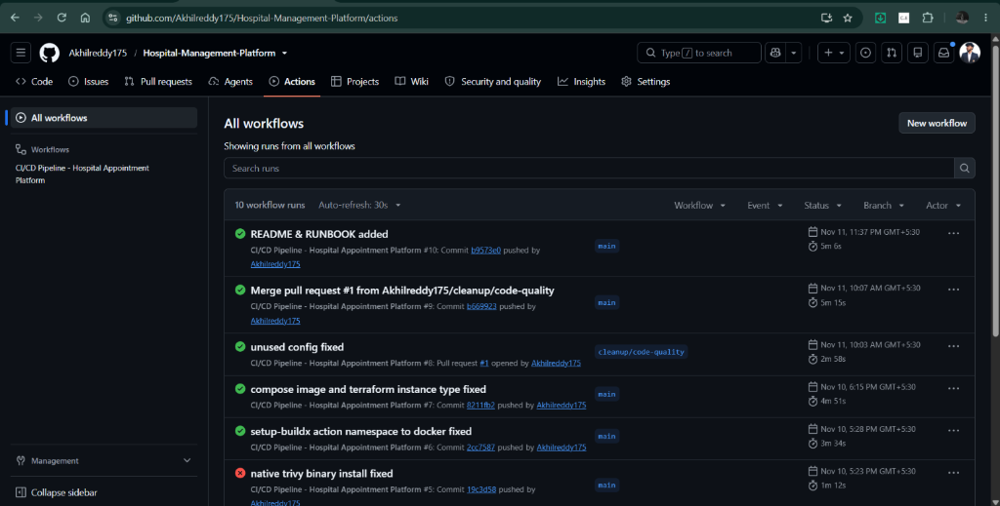
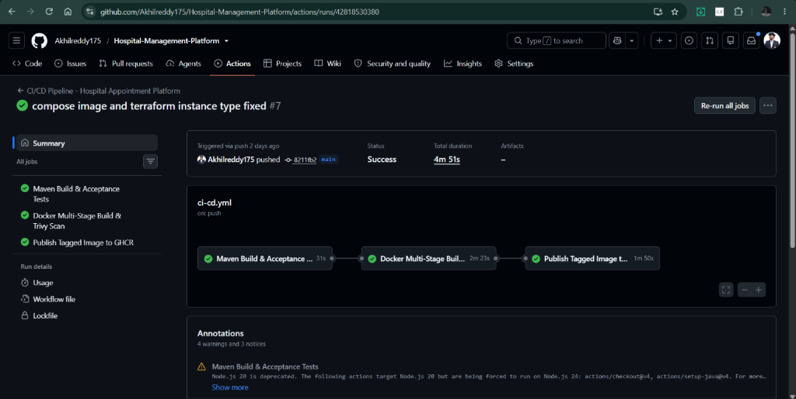
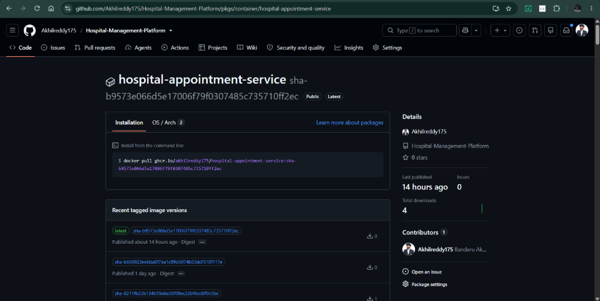
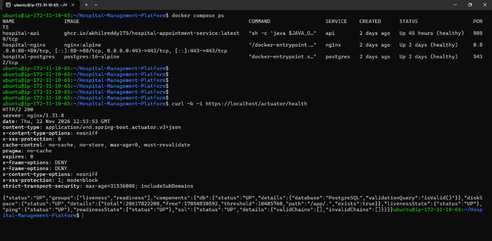
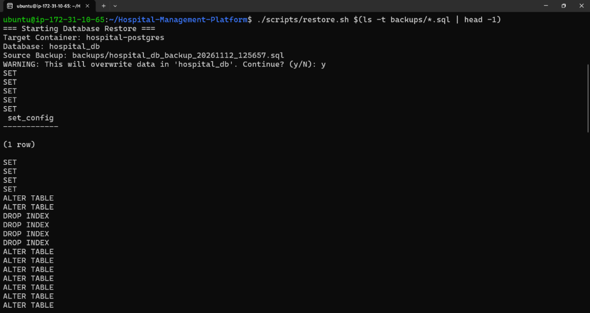
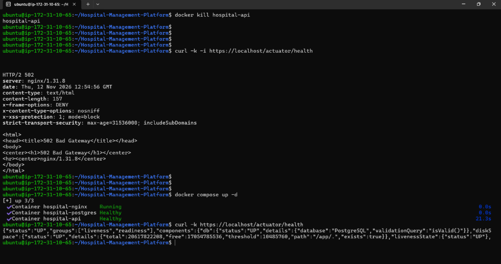
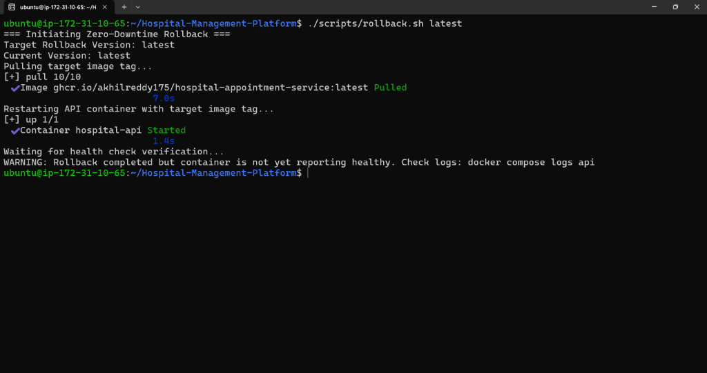

# Project Assessment Evidence

## 1. Project overview

This project is a doctor appointment REST API built with Java 17 and Spring Boot 3.4. The deployment uses PostgreSQL, Docker Compose and Nginx, with AWS EC2 infrastructure provisioned through Terraform. GitHub Actions is used to build, test and publish the application image to GitHub Container Registry (GHCR).

The evidence below records the implementation and checks carried out for the assessment. Screenshots are included where available, with links to the repository and live endpoints.

## 2. Repository and live service

| Resource | Link | What it provides |
|---|---|---|
| Source repository | [Hospital Management Platform on GitHub](https://github.com/Akhilreddy175/Hospital-Management-Platform) | Application source, container configuration, Terraform files, workflow and operational scripts. |
| GHCR package | [Hospital appointment service image](https://github.com/Akhilreddy175/Hospital-Management-Platform/pkgs/container/hospital-appointment-service) | Published container package and available tags. |
| Health endpoint | [https://3.109.203.28/actuator/health](https://3.109.203.28/actuator/health) | Application health response. The endpoint uses a self-signed certificate; use `curl -k` for command-line testing. |
| HTTP redirect | [http://3.109.203.28/actuator/health](http://3.109.203.28/actuator/health) | HTTP endpoint configured to redirect to HTTPS. |
| Doctors API | [https://3.109.203.28/api/v1/doctors](https://3.109.203.28/api/v1/doctors) | Public doctor-listing endpoint. |

**TLS note:** The Nginx certificate is self-signed and issued to `CN=localhost`. It encrypts the connection but is not trusted by browsers as a certificate issued by a public Certificate Authority. A browser warning is therefore expected.

## 3. CI/CD pipeline

The GitHub Actions workflow is located at `.github/workflows/ci-cd.yml`. The workflow runs the Maven verification and test stage, builds and scans the container image, and publishes the image to GHCR for pushes to `main`.



*Figure 1. GitHub Actions workflow runs.*



*Figure 2. Pipeline run showing the test, image build and scan, and image publication stages.*

The screenshots are included as evidence of the displayed workflow run. The workflow file in the repository provides the configuration used by the pipeline.

## 4. Container image

The application is built using a multi-stage Dockerfile. The runtime stage uses a non-root application account. The published image is available in GHCR:

`ghcr.io/akhilreddy175/hospital-appointment-service:latest`



*Figure 3. Published hospital appointment service package and image tags.*

To pull the `latest` tag:

```bash
docker pull ghcr.io/akhilreddy175/hospital-appointment-service:latest
```

Use the package page to check the currently published tags. The `latest` tag can change when a newer image is published; use a commit-specific tag when referring to a particular build.

## 5. Cloud deployment and health check

The service is deployed on an AWS EC2 instance in `ap-south-1`. Docker Compose runs the PostgreSQL database, Spring Boot API and Nginx reverse proxy. The security group is configured for SSH, HTTP and HTTPS access; PostgreSQL is intended to remain on the internal Docker network.



*Figure 4. EC2 terminal showing the Compose services and an Actuator health response.*

The captured terminal output shows the three containers running with healthy status and the health endpoint returning HTTP 200 with the database component reported as `UP`.

The public health endpoint is also provided in Section 2. Because the TLS certificate is self-signed, command-line checks should use:

```bash
curl -k -i https://3.109.203.28/actuator/health
```

## 6. API and appointment concurrency test

The API provides doctor listing and appointment booking, rescheduling and cancellation. The assessment also requires that two competing requests for the same doctor and time slot must not both be confirmed.

The project includes `AppointmentConcurrencyTest.java`, which starts two concurrent booking attempts for the same slot and checks that only one appointment is created successfully.

The CI pipeline screenshot in Figure 2 is evidence that the workflow run completed its test stage. The test source is available in the repository for review.

**Implementation detail to verify before submission:** The database migration defines a unique constraint on `(doctor_id, appointment_time)`. Confirm that the intended behaviour for rebooking a cancelled slot is consistent with this constraint and the service logic.

## 7. Backup, restore and recovery

The project includes scripts for database backup, database restore and application image rollback.



*Figure 5. Database restore script execution on the deployment host.*

The restore script loads a supplied SQL dump into the PostgreSQL container. Restoring a dump can replace existing database contents, so take a fresh backup and stop the API service before carrying out a restore on a live environment.



*Figure 6. API container failure followed by an unsuccessful health request and service recovery.*

The captured drill shows the API container being stopped, the request through Nginx failing while the API is unavailable, and the service becoming available again after the Compose stack is brought up. This demonstrates a manually initiated recovery procedure; it should not be described as automatic self-healing unless an automatic restart policy or orchestrator behaviour is separately verified.



*Figure 7. Execution of the application rollback script.*

The rollback script selects an image tag, pulls it from GHCR and recreates the API service. Check the resulting container health and application endpoint after running the script. A single-container replacement may involve a brief interruption, so this procedure is not described as zero-downtime deployment.